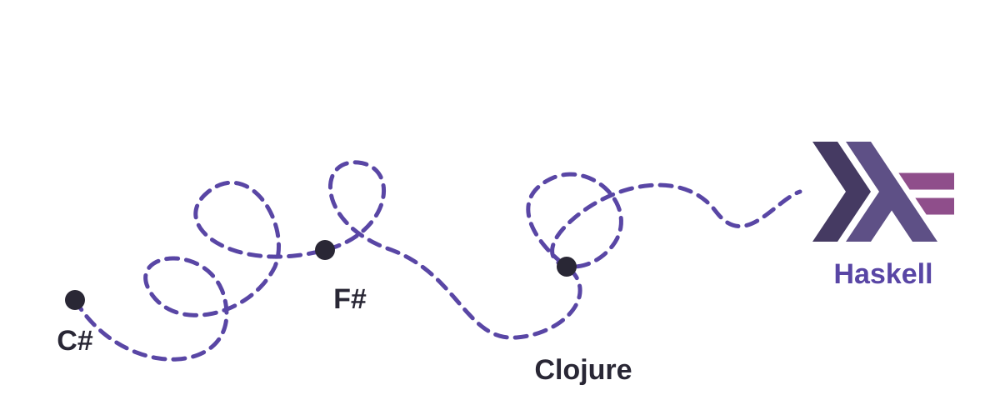
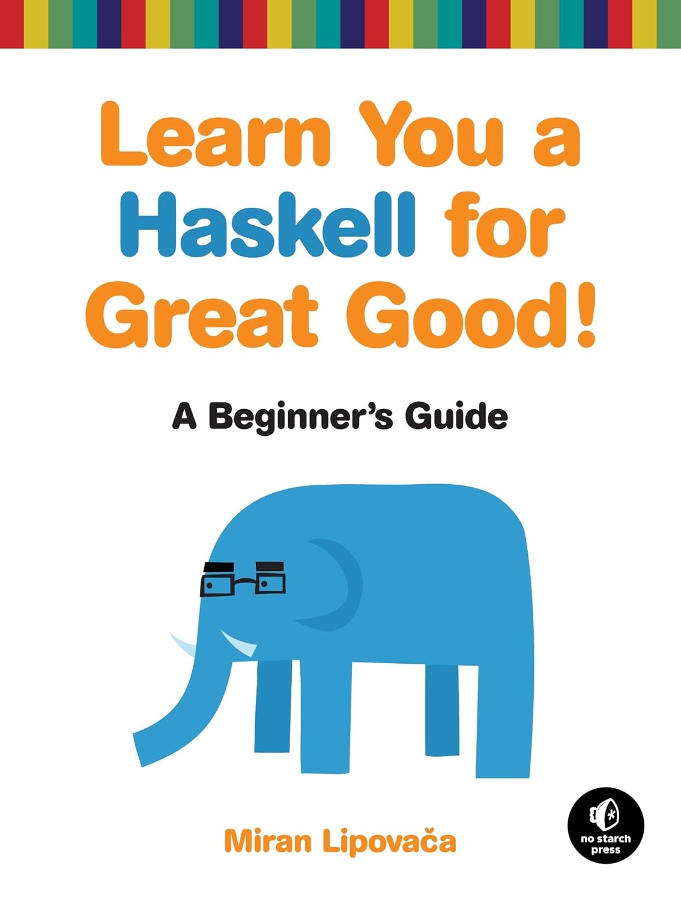
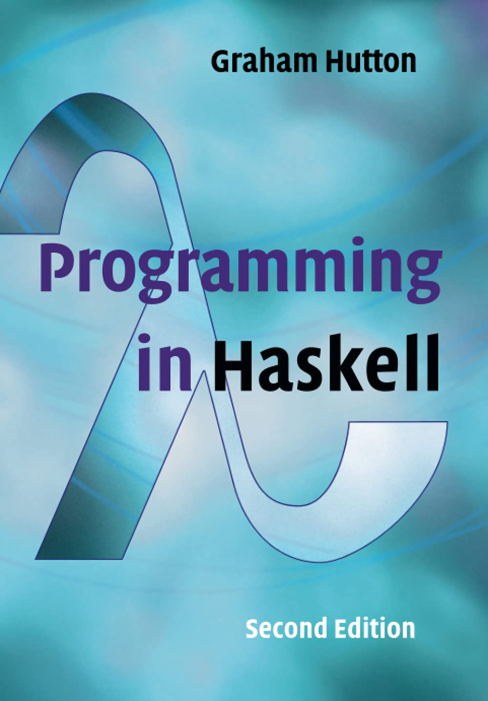
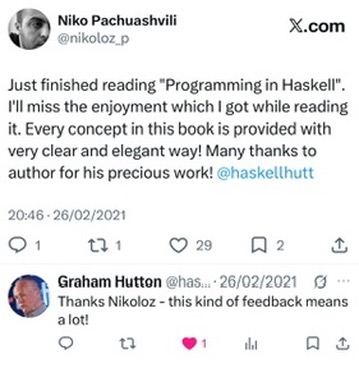

<!-- _class: title -->

# Triage
### Or, How I Finally Got Away With Haskell in Anger

Niko Pachuashvili · niko@twla.io · @nikolozp.bsky.social
MuniHac 2026

github.com/twla-io/triage 

---

# One evening,<br>a doctor called me for help

---

## A tangled path to functional programming

> **Content advisory.** In this part, the author is going to tell the story of his long and tangled path to functional programming.
> He hopes it may inspire those who are taking their first steps, but are still hesitating.

---

<!-- _class: names -->

## SOLID days of OOPera

`IDbProviderAbstractFactoryManager`
`AbstractCustomerRetrievalServiceFacadeImpl`

> Program to an interface, not an implementation.
> — Gang of Four, *Design Patterns*

Why keep all this to myself? **I taught design patterns at a university.**

---

## But something bothered me

- Can this call change shared state?
- Can I swap the order of these two calls?
- Can I run them in parallel?

**So I kept reading the implementations.**

---

## Promises nobody checks

- Signatures didn't answer my questions
- Documentation made promises
- The compiler couldn't check them

---

<!-- _class: code-18 -->

## You'd never guess it from the signature

<pre><code class="language-csharp"><span class="hljs-keyword">interface</span> <span class="hljs-type">IDiscountCalculatorStrategy</span>
{
    <span class="hljs-built_in">decimal</span> <span class="hljs-title function_">GetDiscount</span>(<span class="hljs-type">Order</span> order);
}

<span class="hljs-keyword">class</span> <span class="hljs-type">NoDiscount</span> : <span class="hljs-type">IDiscountCalculatorStrategy</span>
{
    <span class="hljs-keyword">public</span> <span class="hljs-built_in">decimal</span> <span class="hljs-title function_">GetDiscount</span>(<span class="hljs-type">Order</span> order) =&gt; <span class="hljs-number">0m</span>;
}

<span class="hljs-comment">// Only the first 100 orders get the promotion</span>
<span class="hljs-keyword">class</span> <span class="hljs-type">LimitedPromotion</span> : <span class="hljs-type">IDiscountCalculatorStrategy</span>
{
    <span class="hljs-keyword">private</span> <span class="hljs-keyword">const</span> <span class="hljs-built_in">int</span> MaxUsageAllowed = <span class="hljs-number">100</span>;
    <span class="hljs-keyword">private</span> <span class="hljs-keyword">readonly</span> <span class="hljs-type">IDbConnection</span> _db;

    <span class="hljs-keyword">public</span> <span class="hljs-built_in">decimal</span> <span class="hljs-title function_">GetDiscount</span>(<span class="hljs-type">Order</span> order)
    {
        <mark><span class="hljs-keyword">var</span> used = _db.<span class="hljs-title function_">ExecuteScalar</span>&lt;<span class="hljs-built_in">int</span>&gt;(</mark>                   <span class="hljs-comment">// writes to the database</span>
            <mark><span class="hljs-string">"UPDATE Promotions SET Used = Used + 1 OUTPUT inserted.Used WHERE Code = 'FIRST100'"</span>);</mark>
        <span class="hljs-keyword">return</span> used &lt;= MaxUsageAllowed ? order.Total * <span class="hljs-number">0.10m</span> : <span class="hljs-number">0m</span>;
    }
}</code></pre>

---

## Guidance, not guarantees

- SOLID: guidance on how implementations **should** behave
- What I wanted: guarantees about what they **could** and **couldn't** do

---

<!-- _class: punch -->

# <span class="un">un</span>SOLID-ising myself

slowly…

---

## First try: F#

- Discriminated unions and pattern matching
- The compiler warns when I miss a case

---

<!-- _class: code-18 -->

## The Visitor, as I taught it

<pre><code class="language-java"><span class="hljs-keyword">interface</span> <span class="hljs-type">ArithmeticExpressionVisitor</span> {
    <span class="hljs-keyword">void</span> <span class="hljs-title function_">visit</span>(<span class="hljs-type">ConstantExpression</span> expression);
    <span class="hljs-keyword">void</span> <span class="hljs-title function_">visit</span>(<span class="hljs-type">BinaryArithmeticExpression</span> expression);
    <span class="hljs-keyword">void</span> <span class="hljs-title function_">visit</span>(<span class="hljs-type">NegateExpression</span> expression);
}

<span class="hljs-keyword">class</span> <span class="hljs-type">ConstantExpression</span> <span class="hljs-keyword">extends</span> <span class="hljs-type">ArithmeticExpression</span> {
    <span class="hljs-keyword">public</span> <span class="hljs-keyword">void</span> <span class="hljs-title function_">accept</span>(<span class="hljs-type">ArithmeticExpressionVisitor</span> visitor) { visitor.<span class="hljs-title function_">visit</span>(<span class="hljs-keyword">this</span>); }
}

<span class="hljs-keyword">class</span> <span class="hljs-type">ArithmeticExpressionEvaluator</span> <span class="hljs-keyword">implements</span> <span class="hljs-type">ArithmeticExpressionVisitor</span> {
    <mark><span class="hljs-keyword">private</span> <span class="hljs-keyword">double</span> result;</mark>
    <span class="hljs-keyword">public</span> <span class="hljs-keyword">void</span> <span class="hljs-title function_">visit</span>(<span class="hljs-type">BinaryArithmeticExpression</span> expression) {
        expression.<span class="hljs-title function_">getLeft</span>().<span class="hljs-title function_">accept</span>(<span class="hljs-keyword">this</span>);
        <span class="hljs-keyword">double</span> left = <span class="hljs-keyword">this</span>.result;
        expression.<span class="hljs-title function_">getRight</span>().<span class="hljs-title function_">accept</span>(<span class="hljs-keyword">this</span>);
        <span class="hljs-keyword">double</span> right = <span class="hljs-keyword">this</span>.result;
        <span class="hljs-keyword">switch</span> (expression.<span class="hljs-title function_">getOperation</span>()) {
            <span class="hljs-keyword">case</span> <span class="hljs-string">'+'</span>: <span class="hljs-keyword">this</span>.result = left + right; <span class="hljs-keyword">break</span>;
            <span class="hljs-keyword">case</span> <span class="hljs-string">'-'</span>: <span class="hljs-keyword">this</span>.result = left - right; <span class="hljs-keyword">break</span>;
            <span class="hljs-keyword">case</span> <span class="hljs-string">'*'</span>: <span class="hljs-keyword">this</span>.result = left * right; <span class="hljs-keyword">break</span>;
            <span class="hljs-keyword">case</span> <span class="hljs-string">'/'</span>: <span class="hljs-keyword">this</span>.result = left / right; <span class="hljs-keyword">break</span>;
            <mark><span class="hljs-keyword">default</span>: <span class="hljs-keyword">throw</span> <span class="hljs-keyword">new</span> <span class="hljs-type">UnsupportedOperationException</span>(…);</mark>
        }
    }
    <span class="hljs-comment">// visit(ConstantExpression), visit(NegateExpression) …</span>
}</code></pre>

The full version: 7 files, 272 lines

---

<!-- _class: code-20 -->

## The same in F#

```fsharp
type Op = Add | Sub | Mul | Div

type Expr =
    | Constant of float
    | Binary of Expr * Op * Expr
    | Negate of Expr

let rec eval expr =
    match expr with
    | Constant value -> value
    | Binary (left, op, right) ->
        let l, r = eval left, eval right
        match op with
        | Add -> l + r
        | Sub -> l - r
        | Mul -> l * r
        | Div -> l / r
    | Negate e -> -(eval e)
```

---

## But a new language didn't change the way I thought

The .NET Framework was still there.
It didn't let me leave my comfort zone.

**My first F# code: a C# soul, F# clothes.**

---

## Second try: Clojure

- A whole program in parentheses
- Simple, uniform syntax
- Where it clicked: **a statement vs. an expression**

---

## The path



---

## Reading these books changed the way I thought

  

---

## Miran Lipovača's promise


Learning Haskell would feel almost like **learning to program for the first time all over again**.

It would be fun, and it would force you to think differently.

---

<!-- _class: code-20 -->

## The Haskell School of Reasoning


```haskell
reverse (reverse xs) = xs             -- for finite lists
(xs ++ ys) ++ zs = xs ++ (ys ++ zs)   -- provable, by induction

(xs ++ ys) ++ zs   -- 2 * length xs + length ys steps
xs ++ (ys ++ zs)   -- length xs + length ys steps
```

**Can I run them in parallel?** The law answers it, not the implementations.

---

## Many thanks to Graham Hutton…




---

<!-- _class: quote -->

## … and Erik Meijer's prophecy came true

> The skills you acquire by studying this book will make you a much better programmer no matter what language you use to actually program in.

Erik Meijer, foreword to Graham Hutton's *Programming in Haskell*

---

<!-- _class: code-20 -->

## Haskell wearing C# clothes

<pre><code class="language-csharp"><span class="hljs-keyword">public</span> <span class="hljs-keyword">static</span> <span class="hljs-type">Validated</span>&lt;<span class="hljs-type">TrBuyCurrency</span>, <span class="hljs-type">TransactionError</span>&gt; <span class="hljs-title function_">AsTrBuyCurrency</span>(
    <span class="hljs-keyword">this</span> <span class="hljs-type">TransactionType</span> self,
    <span class="hljs-type">IEnumerable</span>&lt;<span class="hljs-type">PartyType</span>&gt; parties)
{
    <span class="hljs-keyword">var</span> actorRolesV = self.<span class="hljs-title function_">ValidateActorRoles</span>(
        x =&gt; x <span class="hljs-keyword">is</span> <span class="hljs-type">SubmissionActorRoleType</span>.Customer);

    <span class="hljs-keyword">return</span> <span class="hljs-keyword">from</span> date <span class="hljs-keyword">in</span> self.<span class="hljs-title function_">DateRequired</span>()
           <span class="hljs-keyword">join</span> _ <span class="hljs-keyword">in</span> actorRolesV <mark><span class="hljs-keyword">on</span> <span class="hljs-number">1</span> <span class="hljs-keyword">equals</span> <span class="hljs-number">1</span></mark>
           <span class="hljs-keyword">join</span> amount <span class="hljs-keyword">in</span> self.<span class="hljs-title function_">ForeignAmountRequired</span>() <mark><span class="hljs-keyword">on</span> <span class="hljs-number">1</span> <span class="hljs-keyword">equals</span> <span class="hljs-number">1</span></mark>
           <span class="hljs-keyword">join</span> branch <span class="hljs-keyword">in</span> self.<span class="hljs-title function_">PlaceRequired</span>() <mark><span class="hljs-keyword">on</span> <span class="hljs-number">1</span> <span class="hljs-keyword">equals</span> <span class="hljs-number">1</span></mark>
           <span class="hljs-keyword">join</span> customer <span class="hljs-keyword">in</span> self.<span class="hljs-title function_">SinglePartyAs</span>(
               x =&gt; x.<span class="hljs-title function_">AsCustomer</span>(),
               <span class="hljs-type">SubmissionActorRoleType</span>.Customer,
               parties) <mark><span class="hljs-keyword">on</span> <span class="hljs-number">1</span> <span class="hljs-keyword">equals</span> <span class="hljs-number">1</span></mark>
           <span class="hljs-keyword">select</span> <span class="hljs-keyword">new</span> <span class="hljs-type">TrBuyCurrency</span>(
               date,
               self.Purpose,
               amount.Amount,
               amount.Currency,
               branch,
               customer);
}</code></pre>

---

## To me, this kind of code was elegant

- Fewer bugs
- Better performance in parallel code
- Refactoring I could reason about

But…

---

## My colleagues could no longer understand my C#…


- I was asked to stop writing code this way
- We maintained this code together, so I understood
- But I couldn't go back to thinking the old way
- That tension almost sent me into… **functional programming depression**

---

## I was hungry to write programs in Haskell

- Solving Codewars katas in Haskell wasn't enough for me anymore
- If I couldn't use my Haskell skills at work, why not create a place where I could?
- **twλa** (Georgian *თვლა*, "counting"): my personal project
  - Teaching programming the functional way from the first day
  - Building real things with a Haskell soul

---


Back to that evening: my friend needed my help.
**It turned out the other way around.**

---

## How I Finally Got Away With Haskell in Anger

*triage* (French *trier*, "to sort"): sorting patients by how urgently they need care, so the most urgent are seen first

---

## How the practice worked

- A patient calls
- The practice records only appointments
- **Free windows worked out by hand**: risk of overlap
- **Dates offered before anyone asks what the patient needs**: no triage
- **An urgent patient could wait far too long**

---

<!-- _class: code-24 -->

## What we built

```haskell
-- The cast, in order of appearance
module Domain
  ( -- Act 1: before anyone calls
    Doctor (..)             -- ready to help, with limited time
  , AvailableSlot (..)      -- her time, published in advance
  , HealthcareService (..)  -- what that time is for
    -- Act 2: someone calls
  , Patient (..)            -- asks to be seen
  , IntakeRequest (..)      -- from the patient's words to an appointment
    -- Stage machinery
  , DoctorCalendar          -- slots and appointments, side by side
  ) where
```

---

<!-- _class: code-24 -->

## `Doctor`

```haskell
-- Deliberately minimal — expected to move to a separate system later.
data Doctor = Doctor
  { id   :: DoctorId
  , name :: Name
  }

newtype Name = Name Text   -- sealed: not empty or only whitespace
```

---

<!-- _class: code-24 -->

## `AvailableSlot`

```haskell
data AvailableSlot = AvailableSlot
  { id                  :: SlotId
  , doctorId            :: DoctorId
  , healthcareServiceId :: HealthcareServiceId
  , start               :: UTCTime
  , duration            :: Duration
  }
```

Are all slots the same?

---

<!-- _class: code-24 -->

## `HealthcareService`

```haskell
data HealthcareService = HealthcareService
  { id       :: HealthcareServiceId
  , name     :: Name
  , duration :: Duration
  }

data Duration
  = QuarterOfAnHour
  | HalfAnHour
  | OneHour
```

- The model lets her decide how her time is shared between services

---

<!-- _class: code-24 -->

## `Patient`

```haskell
-- Deliberately minimal — expected to move to a separate system later.
data Patient = Patient
  { id   :: PatientId
  , name :: Name
  }
```

---

<!-- _class: code-24 -->

## `IntakeRequest`

```haskell
data IntakeRequest
  = Submitted SubmittedIntakeRequest
  | Rejected  RejectedIntakeRequest
  | Accepted  TriagedIntakeRequest
  | Appointed AppointedIntakeRequest
  | Withdrawn WithdrawnIntakeRequest
  | Stale     StaleIntakeRequest
  | Closed    ClosedIntakeRequest
```

---

<!-- _class: code-24 -->

## `SubmittedIntakeRequest`

```haskell
data SubmittedIntakeRequest = SubmittedIntakeRequest
  { id        :: IntakeRequestId
  , patientId :: PatientId
  , narrative :: Text
  , createdAt :: UTCTime
  }
```

**No field for an appointment date. No field for a priority.**

---

<!-- _class: code-20 -->

## `TriagedIntakeRequest`

```haskell
data TriagedIntakeRequest = TriagedIntakeRequest
  { submitted           :: SubmittedIntakeRequest
  , healthcareServiceId :: HealthcareServiceId
  , priority            :: IntakeRequestPriority
  , doctorRequirement   :: DoctorRequirement
  , triagedAt           :: UTCTime
  }

data RejectedIntakeRequest = RejectedIntakeRequest
  { submitted       :: SubmittedIntakeRequest
  , rejectedAt      :: UTCTime
  , rejectionReason :: Text
  }
```

**The first field: the whole submitted request**

---

<!-- _class: code-20 -->

## `IntakeRequestPriority`

```haskell
data IntakeRequestPriority
  = Emergency MustBeSeenBy
  | Urgent    MustBeSeenBy
  | Routine   RoutineDue

newtype MustBeSeenBy = MustBeSeenBy UTCTime

data RoutineDue
  = RoutineAnytime
  | RoutineNotBefore UTCTime
  | RoutineNotAfter  UTCTime
  | RoutineWithin    RoutineWindow

-- Emergency < Urgent < Routine; within tier, tighter deadline ranks first.
instance Ord IntakeRequestPriority where …
```

---

<!-- _class: code-20 -->

## The line: `matchByPriority`

```haskell
matches :: AvailableSlot -> TriagedIntakeRequest -> Bool
matches slot TriagedIntakeRequest { healthcareServiceId, priority, doctorRequirement } =
     slot.healthcareServiceId == healthcareServiceId
  && matchesDoctorRequirement slot doctorRequirement
  && matchesTime priority slot.start

matchByPriority :: AvailableSlot -> [TriagedIntakeRequest] -> Maybe AppointedIntakeRequest
matchByPriority slot =
  listToMaybe . mapMaybe (matchIntakeRequestToSlot slot) . sortByPriority
```

**Calling first no longer beats being urgent**

---

<!-- _class: code-20 -->

## `AppointedIntakeRequest`

```haskell
data AppointedIntakeRequest = AppointedIntakeRequest
  { triaged  :: TriagedIntakeRequest
  , doctorId :: DoctorId
  , start    :: UTCTime
  , duration :: Duration
  }

matchIntakeRequestToSlot
  :: AvailableSlot
  -> TriagedIntakeRequest
  -> Maybe AppointedIntakeRequest
```

**No triage, no appointment: the type can't be built**

---

<!-- _class: code-24 -->

## Endings

```haskell
data WithdrawnFrom
  = FromSubmitted SubmittedIntakeRequest
  | FromAccepted  TriagedIntakeRequest

data CloseReason
  = Completed
  | Cancelled Cancellation
  | NoShow    Absence

closed.appointed.triaged.submitted
```

---

## A request's lifecycle

```text
Submitted → Accepted → Appointed → Closed: completed · cancelled · no-show
Submitted → Rejected
Submitted, Accepted → Withdrawn
Accepted → Stale
```

- Every path is one-way
- Rescheduling = a cancellation + a new request

---

<!-- _class: code-24 -->

## `DoctorCalendar`

```haskell
module Domain
  ( …
  , DoctorCalendarEntry (..)
  , DoctorCalendar             -- sealed: a doctor's entries never overlap
  , mkDoctorCalendar
  , addAvailableSlot
  … ) where

data DoctorCalendarEntry
  = Slot        AvailableSlot
  | Appointment AppointedIntakeRequest
```

**The mistake made by hand can't be constructed**

---

## Weak parts, strong types

| Weak part of the practice | Strong model |
|---|---|
| Free windows worked out by hand | `DoctorCalendar`: no two overlapping entries of the same doctor |
| All help competes for the same time | `HealthcareService`: a request only fits slots of its own service |
| Dates offered before triage | `AppointedIntakeRequest`: no appointment without its triage decision |
| Urgent patients wait too long | `matchByPriority`: a free slot goes to the highest priority that fits |

---

## The model as a specification

```text
Domain.hs → schema → persistence → service → API → UI
```

- `Domain.hs`: written by hand, then fine-tuned with Claude Code
- Every other layer: generated by Claude Code
- One skill per layer: generic rules that never mention the domain
- Every decision written down, with the alternatives I rejected

---

## The rule only the database knew

- No two entries of a doctor may overlap
- Enforced only by PostgreSQL: a `doctor_calendar` shadow table with an `EXCLUDE` constraint
- The only domain rule not yet declared in `Domain.hs`; the calendar view lived in `Service.hs`
- **So I moved it into the specification:** the sealed `DoctorCalendar`, `mkDoctorCalendar`, `addAvailableSlot`

---

## A clean-room run

- **The run:** a fresh agent rebuilds the persistence layer from `Domain.hs` and the skills alone, without seeing the existing code
- **Its task:** point out anything the skills leave open

**The agent proposed a rule:**

> One snapshot per read: a read built from several queries runs them in one REPEATABLE READ transaction.

**My question:** why do I need this? Show me a real example.

---

## The doctor's calendar

- Sealed: `mkDoctorCalendar` rejects overlapping entries
- The database enforces the same rule: an exclusion constraint
- Loaded from storage, the calendar goes through `mkDoctorCalendar`

**How could it reject a calendar the database already keeps valid?**

---

## Two queries, one booking between them

```text
Session A                         Session B
query 1: available slots
  → slot 09:00–09:30
                                  delete the slot
                                  appoint R at 09:00
                                  COMMIT
query 2: appointed requests
  → appointment 09:00–09:30
```

**The same doctor. The same half-hour. Twice.**

---

## A calendar that never existed

- The database was valid before the booking, and after it
- The application assembled a calendar that never existed
- `mkDoctorCalendar` would reject it
- This kind of race is well known: any database textbook describes it
- What surprised me was who found it: not a test, not a user, **a type**

---

## The Smart Constructor Found the Bug

- The earlier AI-generated implementation had this race
- Back then, the calendar was only a view: nothing checked it
- The skill hadn't required the queries to share a snapshot
- Claude Code reproduced it: two real database sessions

---

## READ COMMITTED

```text
-- A, query 1: available slots
 kind |         start          | duration
------+------------------------+----------
 slot | 2026-10-01 13:00:00+04 |       30
(1 row)

-- A, query 2: appointed requests
    kind     |         start          | duration
-------------+------------------------+----------
 appointment | 2026-10-01 13:00:00+04 |       30
(1 row)
```

13:00+04 = 09:00 UTC (the machine's local time zone)

---

## REPEATABLE READ

```text
-- A, query 1: available slots
 kind |         start          | duration
------+------------------------+----------
 slot | 2026-10-01 13:00:00+04 |       30
(1 row)

-- A, query 2: appointed requests
 kind | start | duration
------+-------+----------
(0 rows)
```

- One snapshot, from before the booking
- **Out of date, but consistent**
- A later booking still checks that the slot is free

---

## The fix

```haskell
withTransactionLevel RepeatableRead conn $ do
  -- Read available slots.
  -- Read appointed requests.
```

- The fix was small. Understanding why I needed it was the interesting part
- Now a rule in the skill: one snapshot per read
- The regenerated calendar read follows it

---

## Regenerate, find a gap, write a rule

```text
regenerate → compare → find the gap → write the rule
```

Did the skill decide this, or leave it open?

- Decided: the generated code is wrong
- Left open: the skill is incomplete, so write the rule

---

## The final experiment

- Deleted every generated layer: schema, persistence, service, API, frontend
- A fresh agent regenerated the backend from `Domain.hs` and the skills alone
- Another agent, which never saw the backend, regenerated the UI from the API description
- The tests passed. The API was unchanged
- Four differences became four new rules

**The goal: skills that behave like a pure function of `Domain.hs`**

---

## Before you ask me

How do we know the generated code is correct?

- Does it need review? Yes
- Does it need tests? Yes
- But hand-written code would need both too

**My part: the specification and the tests**

---

## A chain of checks

| Layer | What checks it |
|---|---|
| `Domain.hs` | properties, run directly |
| Schema & persistence | a CHECK per state, the overlap constraint, smart constructors on load, round trips |
| Service | calls the domain functions; tested on real PostgreSQL, lost races included |
| API | every type checked against its published description |
| UI | generated from that description |

---

## What the checks can't catch

- None of this is a proof
- A wrong rule in a skill: every regeneration follows it
- Tests from the same agent might share the mistake
- What nobody thought to test: no test caught the race, only reasoning from a type

---

<!-- _class: punch -->

# Before your questions…

I'd like to show you one last function.

---

<!-- _class: finale -->

```haskell
prost :: 🍺 -> 🍺 -> IO 🍻
prost ich du = say "Danke MuniHac! Prost!" >> ich `clink` du
```

